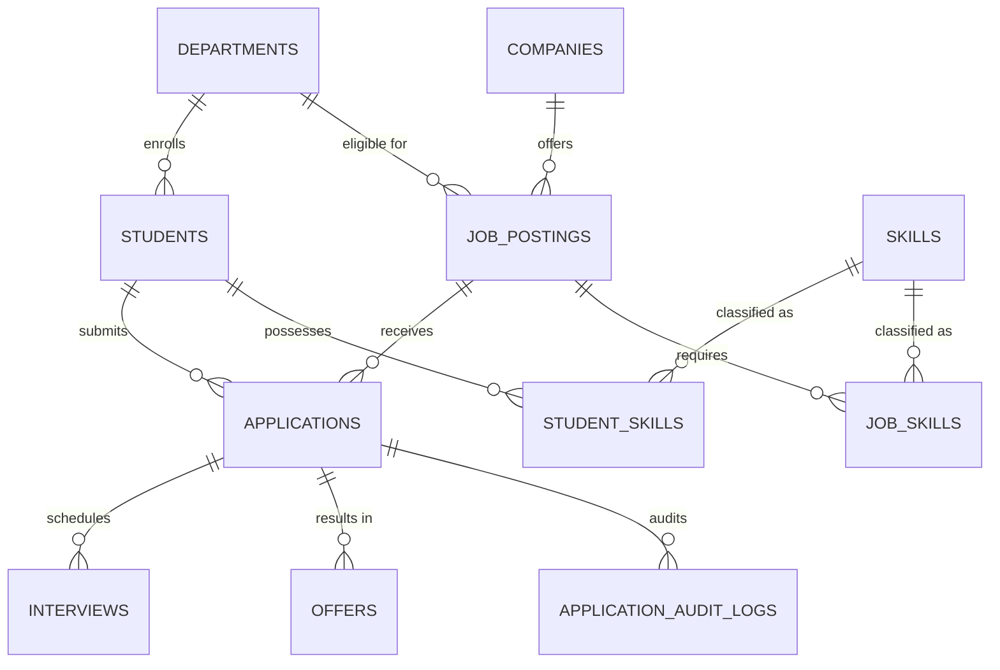

# Campus Placement Portal (Enterprise Edition)

[](https://www.postgresql.org/)
[](https://www.python.org/)
[]()

A robust, enterprise-grade Campus Placement Management System built with **Python** and **PostgreSQL**. This platform manages the complete lifecycle of university placement operations—including student profiles, department affiliations, company job postings, skill requirements, multi-stage application workflows, interview schedules, offers, and audit security.

Migrated from SQLite to PostgreSQL, this Enterprise Edition incorporates production-grade database concepts including **Multi-Dimensional Analytical Reporting (CUBE & ROLLUP)**, **Row-Level Security (RLS)**, **PL/pgSQL Stored Procedures with ACID Transaction Management**, **Automated Audit Logging Triggers**, and **B+ Tree Indexing** for high-throughput query performance.

---

## Table of Contents
1. [Project Overview](#project-overview)
2. [Key Enterprise Features](#key-enterprise-features)
3. [Prerequisites](#prerequisites)
4. [Step-by-Step Setup Guide](#step-by-step-setup-guide)
5. [How to Run the Application](#how-to-run-the-application)
6. [Interactive Menu Guide](#interactive-menu-guide)
7. [DA2 Advanced Features Verification](#da2-advanced-features-verification)
8. [Database Schema](#database-schema)
9. [Project Structure](#project-structure)

---

## Project Overview

The Campus Placement Portal provides university placement cells, department heads, and students with an end-to-end recruitment management engine. It enforces relational integrity across 10 interconnected entities:
- **Students**: Tracks roll numbers, personal details, department affiliations, and CGPA metrics.
- **Departments**: Academic departments coordinating placement activities.
- **Companies**: Corporate recruiters categorized across Tech, Finance, Consulting, and Core sectors.
- **Job Postings**: Open job profiles with package figures (LPA) and minimum eligibility cutoffs.
- **Skills & Requirements**: Technical competencies and mandatory job skill prerequisites.
- **Applications**: Student applications undergoing stage-by-stage status transitions.
- **Interviews**: Scheduled evaluation rounds (Technical, HR, Managerial).
- **Placement Drives & Offers**: Campus hiring drives and final employment offers.
- **Audit Logs**: Transparent, trigger-enforced history tracking every status change.

---

## Key Enterprise Features

- **Advanced Analytical Reporting (CUBE & ROLLUP):**
  Uses PostgreSQL `GROUP BY CUBE (d.dept_name, c.co_name)` inside an optimized Materialized View (`mv_placement_stats`) to compute company-wise, department-wise, and aggregate placement statistics simultaneously.
- **Database-Level Row-Level Security (RLS):**
  Implements PostgreSQL DCL security policies (`CREATE POLICY student_own_policy ON applications...`). Students are restricted by the database engine to only query their own records, while placement staff enjoy full visibility.
- **ACID Stored Procedures (`sp_apply_for_job`):**
  A PL/pgSQL procedure executing application eligibility verification and atomic row-level locks (`FOR SHARE`) within explicit transaction boundaries.
- **Automated Audit Logging via Triggers:**
  The `trg_application_status` trigger fires upon application updates or inserts, automatically generating non-repudiation records in `application_audit_logs`.
- **Performance Tuning via B+ Tree Indexes:**
  Composite B+ tree indexes (`idx_students_dept_cgpa`, `idx_jobs_company_dept`) eliminate sequential table scans on compute-heavy filtering queries.

---

## Prerequisites

Before setting up the project, ensure you have installed:

1. **Python 3.10+**:
   - Verify installation: `python --version`
2. **PostgreSQL Server 14+**:
   - Ensure the PostgreSQL service is running locally (`localhost:5432`).
   - Default superuser `postgres` with access to create databases.
3. **psycopg2 / psycopg2-binary**:
   - Python PostgreSQL database adapter.

---

## Step-by-Step Setup Guide

### Step 1: Clone the Repository
```bash
git clone https://github.com/ArnavSemwal/PlacementPortalalt.git
cd PlacementPortalalt
```

### Step 2: Install Python Dependencies
Install the PostgreSQL database adapter:
```bash
pip install psycopg2-binary
```
*(If building from source with `psycopg2`, ensure PostgreSQL `pg_config` is in your system PATH).*

### Step 3: Create the PostgreSQL Database
Open **psql** command-line interface or **pgAdmin 4**, and create the database named `campus_placement`:

**Using psql CLI:**
```sql
CREATE DATABASE campus_placement;
```

**Using PowerShell / Bash directly:**
```bash
createdb -U postgres campus_placement
```

### Step 4: Configure Database Credentials (Optional)
The script `interactive_demo.py` is configured with default connection settings:
- **Database**: `campus_placement`
- **Host**: `localhost`
- **Port**: `5432`
- **User**: `postgres`
- **Password**: `2007` (Default fallback)

If your local PostgreSQL credentials differ, you can set them using environment variables without modifying any code:

**PowerShell (Windows):**
```powershell
$env:PG_USER="postgres"
$env:PG_PASSWORD="your_postgres_password"
$env:PG_DB="campus_placement"
$env:PG_HOST="localhost"
$env:PG_PORT="5432"
```

**Command Prompt (cmd.exe):**
```cmd
set PG_USER=postgres
set PG_PASSWORD=your_postgres_password
set PG_DB=campus_placement
set PG_HOST=localhost
set PG_PORT=5432
```

**Bash / Linux / macOS:**
```bash
export PG_USER=postgres
export PG_PASSWORD=your_postgres_password
export PG_DB=campus_placement
export PG_HOST=localhost
export PG_PORT=5432
```

---

## How to Run the Application

Run the interactive terminal interface:
```bash
python interactive_demo.py
```

### Automatic Initialization on First Run
Upon first launch, if the database schema is not yet present, `interactive_demo.py` will automatically:
1. Generate all relational tables with primary keys, foreign keys, and constraints.
2. Create the `sp_apply_for_job` stored procedure.
3. Attach the `trg_application_status` audit trigger and initialize `application_audit_logs`.
4. Apply the `student_own_policy` Row-Level Security rule.
5. Create B+ tree indexes and build the `mv_placement_stats` Materialized View.
6. Populate the rich seed dataset.

---

## Interactive Menu Guide

The application features a 14-option terminal dashboard:

| Option | Function | Description |
|---|---|---|
| **1** | Show Tables | Lists all active tables in the PostgreSQL schema. |
| **2** | Describe Tables | Displays detailed column definitions, data types, and nullability. |
| **3** | View Selected Table | Displays all rows from any chosen table with formatted tabular view. |
| **4** | Display All Tables | Quick sequential display of all database tables and current records. |
| **5** | Custom SQL Query | Executes arbitrary `SELECT` queries with runtime tabular formatting. |
| **6** | Insert Record | Interactive prompts to insert records into any table. |
| **7** | Update Record | Updates specific records using primary key identification. |
| **8** | Delete Record | Removes records while honoring foreign key integrity constraints. |
| **9** | Search Records | Wildcard search (`LIKE %pattern%`) across any column. |
| **10** | **Reinitialize & Seed Data** | Drops existing schema, recreates all tables, triggers, and procedures, and seeds 20+ students, 8 companies, 10 jobs, and 35+ applications. |
| **11** | **CUBE & ROLLUP Analytics** | Executes multi-dimensional aggregate queries on `mv_placement_stats`. |
| **12** | **Stored Procedure Demo** | Runs `sp_apply_for_job` and displays real-time `application_audit_logs`. |
| **13** | **Row-Level Security (RLS)** | Compares placement staff view vs. restricted student view. |
| **14** | Exit | Safely closes connections and exits the application. |

---

## DA2 Advanced Features Verification

### 1. Multi-Dimensional Analytical Reporting (Option 11)
- **Concept:** Demonstrates OLAP group functions (`CUBE` / `ROLLUP`).
- **How to test:** Choose **Option 11**.
- **Result:** You will see total offers calculated at three hierarchical dimensions simultaneously: `(Department × Company)`, `(Department Total)`, and `(Grand Total across University)`.

### 2. Stored Procedure & Trigger Audit Trail (Option 12)
- **Concept:** Demonstrates procedural business logic with atomic locking and trigger-based audit logging.
- **How to test:** Choose **Option 12**.
- **Inputs:** Enter Application ID (e.g. `APP099`), Student Roll No (e.g. `25BCE1001`), and Job ID (e.g. `JOB002`).
- **Result:** The procedure validates minimum CGPA requirements, executes `INSERT INTO applications`, triggers `trg_application_status`, and writes an immutable record to `application_audit_logs`.

### 3. Row-Level Security Verification (Option 13)
- **Concept:** Demonstrates DCL-level data isolation.
- **How to test:** Choose **Option 13**.
- **Result:**
  - **Staff View (`app.current_role = 'staff'`):** Displays all student applications across the entire institution.
  - **Student View (`app.current_role = 'student'`):** The database engine silently intercepts the query and returns only applications matching that student's roll number.

### 4. B+ Tree Performance Tuning (pgAdmin / psql)
- **Verification Command:**
  ```sql
  EXPLAIN ANALYZE SELECT * FROM students WHERE dept_id = 'DEP001' AND cgpa >= 8.5;
  ```
- **Result:** Confirms an **Index Scan** utilizing `idx_students_dept_cgpa` instead of a full sequential table scan (`Seq Scan`).

---

## Database Schema



---

## Project Structure

```text
PlacementPortalalt/
├── .gitignore                          # Standard Python ignores (__pycache__, env, etc.)
├── README.md                           # Comprehensive documentation and setup guide
├── interactive_demo.py                 # Main CLI application (PostgreSQL Enterprise Edition)
├── DA2_Implementation_Report.md        # Academic submission report for DA2 deliverables
├── Campus_Placement_Portal_PRD_v1.1.docx # Product Requirements Document
├── ER Diagram.pdf                      # Relational Entity Relationship diagram
├── prd_text.txt                        # Plain-text PRD specification
└── campus_placement.db                 # Legacy SQLite reference database
```

---

## License & Authors
- **Author:** Arnav Semwal
- **Course:** Database Management Systems (DBMS) - DA2 Implementation Deliverables
